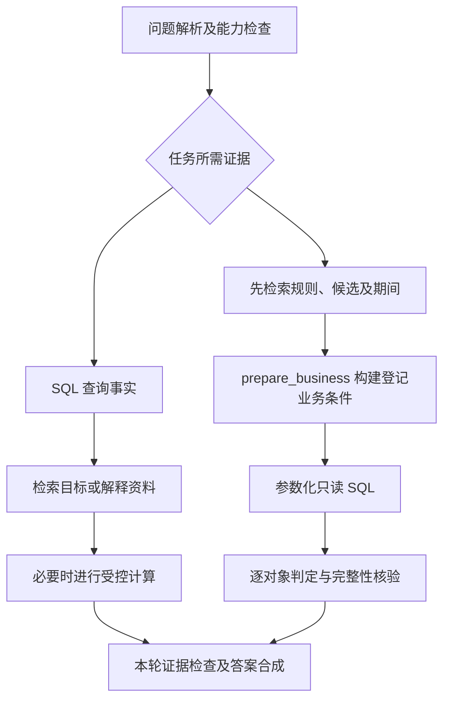

# 阶段二智能体问数：实现改动、开源采用与跨数据集迁移分析

初稿日期：2026-10-10；整合日期：2026-10-11。文档版本：S2-010，分支：`stage2-local`。本文统一记录 S2-006 至 S2-009 的实现、验证及泛化边界；当前运行实现为 S2-009（`7fca3af`，标签 `stage2-S2-009`）。S2-010 仅整合文档和引用，不改变运行代码、题库、评分或数据。

历史 S2-006 的 80 单位成绩保留在第 7 节；扩题后的 S2-009 修复方案、15题及85单位本地结果、完整回答与证据统一放在第 10 节。两轮的题量和模型调用口径不同，不能互相替代。

## 1. 结论与适用范围

阶段二已经补齐多表关联、受控公式计算和跨源问答的核心业务链路。三个部分采用的主要方案分别为：**结构化查询意图与登记查询计划、带来源绑定的命名计算函数、按资料依赖执行并校验结论的跨源工作流**。

这些业务修复由本项目编写代码实现，复用了既有 SQLGlot、LangGraph、SQLAlchemy 等开源基础能力。没有移植 DAIL-SQL 或 LlamaIndex 的整套系统，也没有通过新增通用 Agent 框架完成本次优化。原团队 C 模块属于团队交付，不能因为保存在 `third_party` 下就将其声明为外部开源代码。

当前系统具有可复用的架构，但业务实现仍明显依赖 Chinook。现有评测支持“在当前数据库、业务资料和已登记任务内功能有效”，尚不支持“更换为复杂数据库即可保持同样效果”。**AdventureWorks 尚未进行真实迁移评测，准确率、响应时间、吞吐量均未知。**

历史 S2-006 完整业务回归为 **78/80**，其中多表 **8/8**、公式 **6/6**、跨源 **10/10**。扩题和局部修复后的 S2-009 本地验证为基础 **15/15**、全量 **83/85**，三个重点专项仍全部通过。后者实际模型调用为 0；这些成绩不能解释为大模型直接生成正确率，完整在线验收仍待复测。历史与当前验证口径分别见第 7、10 节。

## 2. 修改基线、责任边界与版本演进

本报告依据本地 Git 历史、实际源代码、安装依赖元数据及保留的测试记录编写。原 S2-006 分析范围 `fc21336..d30d8e1` 的差异涉及 42 个文件，增加 2737 行、删除 148 行，包含业务代码、配置、测试、评分脚本及说明文件；行数不等于全部为新增算法。

| 版本 | 提交 | 本次阶段二工作的主要内容 |
|---|---|---|
| S2-000 | `fc21336` | 保存实施基线与本地版本约定 |
| S2-001 | `32c9288` | 校准评分、保留逐题结果与失败证据 |
| S2-002 | `5b64249` | 保留日期与聚合语义，修复 Top-N 和比较周期查询 |
| S2-003 | `3bc4307` | 多表连接、分组、去重及结果列契约 |
| S2-004 | `4300c50` | 文档证据读取、公式绑定、跨源答案组合 |
| S2-005 | `ad418a8` | 兼容性、单位和周期绑定收尾，完整业务回归 76/80 |
| S2-006 | `d30d8e1` | 按原指令第 20 节补齐客户分层、海报候选成交及结论证据，业务回归 78/80 |
| S2-007 | `2660360` | 编写三个重点模块技术方案、开源归属及泛化性分析，运行实现不变 |
| S2-008 | `ff68919` | 基础题库扩充至15题，严格评分与独立标准SQL核对；全量分母变为85单位 |
| S2-009 | `7fca3af` | 局部修复编号/目录属性、客户阈值、零成交外连接；基础本地15/15、全量83/85 |
| S2-010 | 标签 `stage2-S2-010` | 按用户要求整合为本文件，更新引用，运行实现仍为S2-009 |

继承并继续使用的基础设施包括 C 的 Schema 反射、只读执行器、SQL 安全校验、模型 JSON 接口，以及 B 的 LangGraph、工具运行时、证据模型、会话和响应结构。阶段二主要修改规范实现 `backend/sql_module` 与 `services/agent_api/app`，冻结的 `third_party/chinook_c` 副本仍保留作为历史来源，不在该副本中混入本次修复。

业务事实来自真实 Chinook 样例库和团队提供的业务资料。目标、候选名单、分层规则属于业务输入；评测 gold 与新增评分断言仅用于验证，不进入运行时生成答案的逻辑。

## 3. 多表关联：修改了什么，如何解决

### 3.1 原问题及原因

原实现的问题不仅是 SQL 无法执行。部分 SQL 能执行，但分组对象、筛选期间、去重方法或返回列不符合问题：

- “前五个商品并列出专辑、艺术家”被误当成不同聚合粒度，或 Top-N 退化成单行。
- 支持负责人客户分布被聚合成一个总数，没有按负责人返回三组。
- 一张订单包含多个明细时，直接计数会重复计算订单或客户。
- 候选 SQL 与业务上下文不完整对应，媒体、时间或实体筛选可能丢失。
- 合法结果的列名大小写、行序差异造成不必要拒答或评分误判。

### 3.2 新增结构化查询意图

新增 [`query_intent.py`](../backend/sql_module/query_intent.py)；B 解析后通过 `resolved_slots.query_intent` 把查询结构传给 C。主要信息包括：

| 字段 | 含义 | 示例 |
|---|---|---|
| `dimension` | 聚合粒度 | 商品、专辑、艺术家、客户、负责人、月份 |
| `measures` | 返回哪些指标 | 销售额、订单数、购买客户数 |
| `top_n` | 排名数量 | 5 |
| `order_by` / `order_desc` | 排序指标及方向 | 销售额降序 |
| `include` | 补充属性 | 商品排行附带专辑和艺术家 |
| `operation` | 登记的特殊查询操作 | 混合媒体订单、客户人群、文档候选；S2-009新增目录属性 |
| `track_ids` | 商品编号限定（S2-009完善） | 单个编号、离散列表、有界范围 |
| `amount_filter` | 聚合金额阈值（S2-009新增） | 客户音频消费额不少于10美元 |
| `include_empty` | 保留零成交维度（S2-009新增） | 列出全部媒体类型，包括零成交 |

例如“2025 年第三季度销售额最高的五个商品，同时列出专辑和艺术家”，仍按商品 ID 聚合，专辑与艺术家作为补充属性。`top_n` 保留用户指定数量，并对允许的维度、度量和取值进行验证。解析目前采用有限词汇及规则匹配，尚未实现任意自然语言到任意关系查询计划的转换。

### 3.3 增加业务语义检查，保留只读校验

新增 [`semantic_scope.py`](../backend/sql_module/semantic_scope.py)，使用 SQLGlot 把模型候选解析为 AST，再检查已覆盖的业务结构：

- 日期边界是否为 `InvoiceDate >= start` 且 `< end`；比较周期是否分别对应 current/previous。
- 音频范围、品类与账单国家筛选是否与本轮条件一致。
- Top-N 是否保留 LIMIT、销售额降序及正确分组键。
- 月度问题是否保留月份表达式及月度分组。
- 对不在该检查器可确认范围内的外连接、OR 等结构采取保守处理。

S2-009 对目录属性、客户阈值和零成交计划补充了含绑定值的登记计划 AST 比对；允许的是已验证的计划形状，没有普遍放开任意外连接。具体方案见第 10.2 节。

这层检查与 C 的执行安全校验分别承担业务范围与执行安全职责。SQL 可解析、只读且列名合法，并不自动证明业务正确。当前检查器也不构成完整 SQL 语义等价证明：它识别的是有限的规范形式，复杂 CTE、等价表达式或未覆盖的连接条件可能被拒绝，也可能存在检查缺口。

### 3.4 修改登记查询计划和返回契约

修改 [`service.py`](../backend/sql_module/service.py)，扩展 `GRAIN_PLANS`、`EXTRA_GRAINS`、`MEASURE_EXPRESSIONS`、`_controlled_query()` 和 `_output_contract()`。

| 查询 | 使用的关联或粒度 | 解决的问题 |
|---|---|---|
| 商品销售排行 | InvoiceLine → Invoice → Track → Album → Artist；商品 ID 分组 | 补充属性不改变商品粒度，返回正确 Top-N |
| 专辑、艺术家销售排行 | Track → Album → Artist；按对应主键分组 | 避免按名称或错误粒度混合汇总 |
| 支持负责人客户分布 | Invoice → Customer → Employee；负责人主键分组 | 返回各负责人的去重购买客户数 |
| 品类订单与客户分布 | 明细 → 商品 → 品类；品类主键分组 | `COUNT(DISTINCT InvoiceId)` 与 `COUNT(DISTINCT CustomerId)` |
| 播放列表商品数 | Playlist → PlaylistTrack；列表分组 | 去重商品数，避免将列表收录数解释为销量 |
| 同时含音频与视频的订单 | 订单粒度分组，再以条件聚合检查两类明细存在 | 每张符合条件的订单仅计一次 |
| 月度销售额 | 按 `strftime('%Y-%m', InvoiceDate)` 分组 | 返回三个月而非单个季度总额 |

排行计划以度量降序、维度主键作为次级排序，稳定处理并列。本样例商品 Top-5 存在金额并列，因此不能把选出的五个商品解释为独占前五。

结果列大小写先按已登记契约归一化，缺少必要语义列时才尝试登记计划修复。评分器按题目要求区分行序是否具有业务意义，避免无序分组结果仅因行序不同失败；排行榜仍需检验排序与集合。

`validation.py` 的结构白名单增加 `DPipe`，用于姓名字符串拼接；这项改动没有开放写操作、任意函数或任意表访问。

模型正常生成的候选经过业务检查和只读执行。模型超时、网络或响应故障，或已支持任务的候选范围/列契约不完整时，可以切换登记的受控计划，并在答案限制与 trace 中说明。无法覆盖的任务不会凭空构造业务答案；查询执行失败也不等于已被任意自动修复。

### 3.5 当前实现边界

计划中仍直接写有 `main.Invoice`、`InvoiceLine`、`Track` 等表，以及对应主键和表达式；混合媒体订单使用 Chinook 的媒体 ID 约定。`semantic_scope.py` 当前以 SQLite 方言解析并识别 Chinook 列名。底层支持 CTE/子查询的安全执行，与阶段二业务检查器支持这些结构的程度不同。

因此，该方案可以覆盖登记维度下的多表问数，但目前不支持自动发现任意新数据库的连接路径、任意多维组合、层级递归或所有复杂窗口查询。

## 4. 公式计算：修改了什么，如何解决

### 4.1 从结果数字转为有来源的操作数

新增 [`business_calculation.py`](../services/agent_api/app/integrations/business_calculation.py)，从本轮 SQL 结果与检索文档创建计算证据；扩展 [`binding.py`](../services/agent_api/app/evidence/binding.py) 和 [`evidence/models.py`](../services/agent_api/app/evidence/models.py)。

SQL 操作数包含 query ID、行号、列名、结果 hash、指标、单位、期间和范围。文档操作数包含文档/块 ID、版本、内容 hash、数值字符区间及来源定位。实际值、目标值、本期值、基期值分别绑定，而不是只把两个数字传给计算器。

在实际资料中，目标读取绑定 D06 第 1 页具体品类及金额/销量列；月度计划读取绑定 D06 第 2 页三个月的计划值。资料标题声明的年份季度必须与请求一致，不把旧目标自动套用到新周期。

### 4.2 扩展受控函数，计算器负责确定性运算

继续使用 Python 标准库 Decimal，修改 [`local_calculator.py`](../services/agent_api/app/tools/local_calculator.py)。原差额、达成率和增长率能力得到业务证据接入，增加客单价和月度求和支持，并扩展输入/输出检查。

| 函数 | 公式 | 当前控制条件 |
|---|---|---|
| `difference` | 实际 − 目标，或本期 − 上期 | 两个同口径操作数；允许结果为负 |
| `attainment_rate` | 实际 ÷ 目标 × 100 | 目标非零，结果单位为 % |
| `growth_rate` | (本期 − 上期) ÷ 上期 × 100 | 比较周期明确，基期非零 |
| `average_order_value` | 销售额 ÷ 去重订单数 | 当前限定 USD、单，输出 USD/单；订单数非零 |
| `sum` | 月度操作数求和 | 命名月份、单位一致；计算器允许 2—12 项，当前 D06 读取器为完整季度 3 项 |

操作数按有限值、精度、量级、单位及计数整数性验证。内部 Decimal 运算后按两位小数、ROUND_HALF_UP 舍入，并检查公开 JSON 数字是否保留该结果。SQL 汇总本身仍可能使用数据库的数值类型及 ROUND；Decimal 计算器不能追溯修复数据库汇总阶段已经发生的精度损失。

### 4.3 先验证、授权，再运算和复核


计算授权与 request/session/profile 关联，不能由客户端提供“已确认”的数字绕过绑定。工具执行前检查授权，执行后按获准请求重新计算结果；响应合成时继续检查本轮证据。禁止用 `eval/exec` 执行任意文档公式。

这解决了“算术结果正确但用了错误目标/单位/季度”的问题，也解决了只返回 SQL 结果却没有差额、达成率或最终判断的问题。

### 4.4 验证示例与边界

当前证据中的示例：全部音频实际 112.86 USD 对目标 120 USD，差额 −7.14 USD；Rock 实际 47.52 USD 对目标 50 USD，达成率 95.04%；月度计划 38、40、42 USD 求和得到 120 USD。上述数字来自样例库和 D06，本文只是记录结果，不在运行时写入这些预期答案。

计算器的五类算术可复用，但业务操作数读取器仍绑定 D06 格式、品类与音频范围。现有输入禁止负数，计数必须为整数，没有自动汇率换算、任意公式解析、税率/利润/成本或复杂财务口径。AdventureWorks 若需要退款负数、多币种或成本计算，必须先扩展相关契约、来源绑定和验证。

## 5. 跨源问答：修改了什么，如何解决

### 5.1 流程从简单拼接扩展为显式依赖

修改 [`graph.py`](../services/agent_api/app/agent/graph.py)，增加 `prepare_business`、业务来源状态和业务审计状态；新增 [`business_workflows.py`](../services/agent_api/app/evidence/business_workflows.py) 与 [`business_queries.py`](../backend/sql_module/business_queries.py)。

当前存在两类主要执行方向：



普通达标/增长问题通常是 SQL → 文档 → 计算；客户分层、海报候选则是文档 → 业务条件 → SQL → 判定。当前图按这些有限流程串行执行，没有实现自动拆解任意复杂任务的通用规划器，也没有把 SQL 与检索一律并行。

### 5.2 客户分层：人群与金额范围分开

原缺陷是将“购买过 Rock 的客户”与“客户当季全部音频消费金额”混为一个过滤范围。如果先在 WHERE 中只留下 Rock 明细，就会用 Rock 金额代替分层所需的全部音频金额。

现在先从 D04 读取 A 层阈值、全部音频金额定义和规则适用期，再查询完整音频事实。在一次客户聚合中：

1. 用 `CASE WHEN GenreId = cohort_genre_id` 计算 Rock 金额及去重订单数，确认购买人群。
2. 用全部匹配音频明细计算 `all_audio_sales_amount`，不在 WHERE 中排除其他品类。
3. 用 HAVING 保留实际购买过指定品类的客户。
4. 将完整音频金额与文档读取的阈值做 Decimal 比较，给出最终 A 层名单。

这样避免多次事实连接导致金额重复。阈值与客户名单不写死在业务逻辑里；查询返回的人群中间结果与最终符合阈值的名单分开。每个最终客户的结论引用 SQL 金额单元格、购买事实单元格、规则及适用期。

当前仅实现 D04 有明确适用期的 A 层金额规则、单品类人群、完整季度。尚未覆盖所有层级、地区叠加、多条件人群或任意分层文档格式。

### 5.3 海报候选成交：文档集合交集与零成交保留

新增 [`entity_ids.py`](../services/agent_api/app/agent/entity_ids.py)，先识别商品 ID 列表/范围，再在时间解析时屏蔽这些片段，避免把四位商品编号误识别成年份；支持连字符、短破折号、“至”和离散列表。

流程从 D05 对应品类及季度的明确候选名单、D11 可定位的音频主页面条件和用户编号范围中取交集。候选不由“范围内所有整数”或奇偶规律推断。

查询以商品目录为起点，LEFT JOIN 已按日期和媒体范围筛选、按商品聚合的成交子查询。因此候选存在而无成交时仍保留，返回零金额与零订单。日期条件放在事实子查询内部，避免外层 WHERE 把无成交候选过滤掉。

答案区分：有成交、查询成功的零成交、文档集合无交集、数据库目录缺项、查询失败及结果截断。不能把查询失败或缺失当成零成交。每个商品同时绑定候选引用、海报图片定位和成交金额单元格。

两条新增文档依赖流程使用服务端选定的登记 SQL，**正常设计就不调用模型生成 SQL**；统计时与模型失败后的受控降级分开。模型主要用于其他查询候选生成，不能将两条本地流程的正确性计为模型生成能力。

### 5.4 检索、资料读取与时间范围修复

修改 [`documents.py`](../services/agent_api/app/knowledge/documents.py)、[`index.py`](../services/agent_api/app/knowledge/index.py) 与 [`parsing.py`](../services/agent_api/app/agent/parsing.py)：

- DOCX 表格保留行/列文本结构，避免阈值表被拆散；PDF 保留表格上下文；图片保留全图上下文及 bbox 定位。
- 检索沿用本地词项、IDF 权重与文档提示，并增加必需规则、范围、适用期和候选片段优先级。当前没有新增向量数据库或 embedding 检索。
- 月度问题需要完整月份集合，资料声明年份季度与请求必须对应；不把季度目标代替单月计划。
- 对明确业务资料声明的有限场景可采用已登记年份；缺年份问题仍可能需要澄清，不能全局默认 2025。
- 必需文档因 top_k 太低或来源缺失而未检索到时，返回证据不足，不补造规则。

这些是对当前 D01—D12 文档的有限优化。加载器还检查固定文档集合和团队资料快照；任意新知识库不能直接沿用这套固定 manifest 约束。

### 5.5 结论与证据绑定、冲突处理

修改 [`composer.py`](../services/agent_api/app/response/composer.py)，计算回答先给结论，再解释实际/目标、公式和来源；业务流程逐客户/商品引用判定依据，并重新核对本轮来源和审计结果。原始资料摘录仍存在于普通 RAG 回答中，并非所有问题都已完成高质量语义归纳。

新增 [`claim_comparison.py`](../services/agent_api/app/evidence/claim_comparison.py)，先比较指标、实体、期间、单位和范围，再比较数值角色：

| 条件 | 处理 |
|---|---|
| 指标、实体、期间、单位或范围不同 | 不可直接比较，并说明不同项 |
| 同口径，但一方目标、一方实际 | 业务差距，不作为资料冲突 |
| 同口径、同角色、不同数值 | 保留冲突双方数值、来源及差额 |
| 同口径、同角色、数值相同 | 一致 |

已用于月度跨源答复等登记场景。例如 D08 八月记载 36.63 USD，而数据库同口径结果为 37.62 USD，保留双方并说明差异。该模块提供通用比较结构，接入的资料主张提取仍按登记来源实现；它没有自动解决任意文档的全部矛盾。

## 6. 开源采用与来源说明

### 6.1 三个重点模块的明确归属

| 重点模块 | 实际复用的开源能力 | 本项目编写的部分 | 未采用的方向 |
|---|---|---|---|
| 多表关联 | SQLGlot AST；SQLAlchemy/既有 C 执行器基础 | 查询意图、Chinook 粒度计划、范围检查、返回列契约及透明修复 | 未移植 DAIL-SQL 源码或其完整运行环境 |
| 公式计算 | Python Decimal 标准库；既有 Pydantic 类型验证 | D06 操作数读取、来源绑定、命名函数扩展、单位/期间检查、授权与复核 | 未引入第三方公式引擎或执行任意文档表达式 |
| 跨源问答 | LangGraph 状态图、条件路由；已有 PDF/OCR 读取能力 | 文档依赖流程、候选集合、客户分层、参数化业务查询、结论证据及冲突比较 | 未安装或复制 LlamaIndex、Haystack、Docling、额外规则引擎 |

“本项目编写”指本轮业务修复的来源，不表示所有基础算法首创或不依赖团队原代码。条件聚合、集合交集、Decimal 和来源校验属于常见技术；本次工作的贡献在于将其按项目业务口径实现、集成并验证。

### 6.2 已安装依赖版本及采用位置

版本于本次文档核对时由 `.venv` 的安装元数据读取；许可证信息来自对应安装包，不以当前上游最新版代替本地版本。

| 组件 | 本地版本 / 许可证 | 实际采用位置及范围 |
|---|---|---|
| SQLGlot | 27.29.0 / MIT | `semantic_scope.py`、C `validation.py`；解析和遍历 SQL AST，继承只读表列校验 |
| LangGraph | 1.2.12 / MIT | `agent/graph.py`；沿用状态、节点、条件边与检查点基础 |
| SQLAlchemy | 2.0.54 / MIT | C `schema.py`、`execution.py`、数据库适配；连接、反射和查询执行 |
| pypdf | 6.19.0 / BSD-3-Clause | 已有 PDF 阅读路径，阶段二改善解析后表格与上下文组织 |
| rapidocr-onnxruntime | 1.4.4 / Apache-2.0 | 已有图片 OCR 路径，阶段二改善全图/定位信息的检索使用 |
| Pydantic | 2.13.5 / MIT | 已有请求、工具及证据数据模型，扩展证据字段和校验 |

SQLGlot 的 AST 遍历能力来自其公开接口，具体业务检查由本项目编写。[SQLGlot v27.29.0 文档](https://github.com/tobymao/sqlglot/tree/v27.29.0)、[该版本许可证](https://github.com/tobymao/sqlglot/blob/v27.29.0/LICENSE)。LangGraph 提供工作流编排基础，本项目据业务依赖设置节点和分支。[LangGraph 工作流官方文档](https://docs.langchain.com/oss/python/langgraph/workflows-agents)。

本地 LangGraph 与 SQLGlot 包分别保留 `langgraph-1.2.12.dist-info/licenses/LICENSE`、`sqlglot-27.29.0.dist-info/licenses/LICENSE`；本轮未修改上游库源码，也未新增这些依赖。分发依赖时继续保留相应声明；RapidOCR 所用推理组件与模型资产如需分发，应按实际资产另外核对，包的许可证不能代表所有资产。

### 6.3 指令中的参考方向与实际采用的区别

原设计文档建议 DAIL-SQL 的 Schema/示例组织和 LlamaIndex 的 SQL+文档组合流程作为参考。代码和版本记录并不支持声称已移植这些项目或复现其公开成绩。

DAIL-SQL 当前未作为安装依赖、源码移植、示例选择器或专门 Schema Linking 系统接入。模型使用现有 C JSON 候选生成接口及业务上下文；不能把本次 AST 修复描述为已实现 DAIL-SQL。

LlamaIndex 仅是原指令中的组合流程参考方向；本次实际采用的是本项目在 LangGraph 中编写的文档先行/SQL 先行流程。其官方示例不能直接替代客户分层或海报业务规则。[LlamaIndex SQL Auto Vector Query Engine 示例](https://developers.llamaindex.ai/python/examples/query_engine/sqlautovectorqueryengine/)。本项目当前检索为本地词项检索，也不能描述为已实现该示例的向量检索系统。

### 6.4 团队交付和样例数据

`third_party/chinook_c/NOTICE.md` 明确 C 来源为团队提供的 `chinook-business-agent-main.zip`；`artifact-manifest.json` 保留归档及逐文件 hash。包内没有 C 整体开源许可证，因此不能把团队 C 实现列为已经获得外部开源许可的代码。

Chinook 样例数据库许可证另保存在 `data/chinook/LICENSE.md`，MIT 声明与作者归属仍保留。业务资料、团队 C、开源依赖和样例数据分别追踪来源。

## 7. 验证结果与成绩解释

### 7.1 历史 S2-006 功能回归（80单位）

S2-006 当时的正式题库为原 80 个评分单位，执行了 90 次问答；多轮按会话单位评分。S2-008 后变为85单位、95次请求，新增五题成绩没有计入这张历史表。S2-006 开始/结束的代码、评分、题库和数据指纹一致。

| 分组 | 结果 |
|---|---|
| 基础 NL2SQL | 10/10 |
| 基础 RAG | 10/10 |
| 澄清 | 8/8 |
| 别名与表达鲁棒性 | 8/8 |
| 多表关联 | 8/8 |
| 公式计算 | 6/6 |
| 多模态 | 5/5 |
| 负例 | 5/5 |
| 跨源问答 | 10/10 |
| 多文档 | 4/5 |
| 多轮 | 4/5 个会话 |
| 总计 | 78/80，97.5% |

未通过项仍保留：`multidoc-002` 的目标/复盘/活动方案关系说明缺少评分要求的“附属/补充”关系表述；`session-002` 未指定年份的季度切换与增长率三轮均仍要求澄清。前者需要人工语义核对和回答改进，后者需要解决年份依据与会话策略，不能靠放松断言记为通过。

多表 001/002/003 的完整结果各 5 行，006 为 3 位负责人，007 的完整响应为 10 个音乐分类，008 为 17 张混合订单。`report.json` 仅展示部分行和答案摘录，完整证据应读取 `responses.jsonl`；不能把报告展示的 6 行误认作实际只返回 6 行。

### 7.2 历史在线模型与受控执行分别统计

S2-006 完整运行实际模型成功 4 次、超时 5 次；达到累计失败预算后，55 次调用尝试暂缓。30 个响应采用透明受控修复/降级，另 2 条新增文档依赖业务查询有意不调用模型。上述计数分别按模型尝试、响应和业务流程统计，不能直接相加当成题目数。

因此 78/80 是这次运行的**完整系统业务结果**，完整模型在线验收仍待外部 API 复测。暂缓项没有计为模型调用通过，也未从题库删除。

开发中的跨源专项也得到 10/10，7 次模型成功，1 次 HTTP 故障及 1 次超时重试恢复；由于该专项期间收紧了评分断言，其评分指纹变化，虽按最终政策重新评分仍为 10/10，仍不替代最终固定 80 单位验收。

S2-005 曾完成无 API 暂缓的 76/80 系统运行，其中模型实际成功 33 次、1 次超时重试恢复、8 个响应记录受控修复。旧响应按最终 v1.4 重评分仍为 76/80、跨源 8/10，说明 S2-006 新通过的 cross-004/006 不来自放宽评分。

### 7.3 历史 S2-006 工程检查与证据路径

后端完整检查 147/147，另新增评分防误判检查 2/2；这是两次检查合计 149 项通过。C/SQL 契约检查共 55 项，其中 52 通过、3 跳过：2 项 AdventureWorks PostgreSQL 真实集成因未配置跳过，1 项 C 独立真实模型测试因未显式启用跳过。后者与另行执行并保留记录的智能体在线评测不同。工程检查通过不等于真实模型测试或新数据库迁移通过。

- 固定完整运行：`tmp/stage2-eval/20261010T091649Z-live-930fe3a4/`，含 `report.json`、`responses.jsonl`、`model-calls.jsonl`、`acceptance-summary.json`、指纹与版本关联文件。
- 后端检查：`tmp/stage2-r2-backend-r1.log`；SQL/C 检查：`tmp/stage2-r2-c-r1.log`；评分检查：`tmp/stage2-r2-scoring-tests-r2.log`。
- 验收说明：[stage2-acceptance.md](stage2-acceptance.md)；逐版备注：[stage2-progress.md](stage2-progress.md)；评分规则：[stage2-scoring-policy.md](stage2-scoring-policy.md)。

`tmp` 原始记录目前仅保存在本机，Git 不跟踪它们；回溯运行代码和文档不等于自动恢复临时目录中的原始测试产物。对外提交或长期归档时，应单独保留原始证据及 hash，并按同版本重新运行。本文保留来源索引，未把含大量响应的临时目录加入版本库。

## 8. 当前代码的泛化性：逐层评估

这里区分三种能力：同库换问法/参数、相似结构换数据库、跨领域复杂数据库迁移。没有以当前小题库全通过来证明第三种能力。

| 层次 | 可复用内容 | 当前绑定或缺口 | 迁移判断 |
|---|---|---|---|
| 工具与流程架构 | LangGraph、类型化工具、超时预算、状态与 trace | 工厂默认 Chinook profile，业务节点为有限工作流 | 架构可复用，需要另行装配 |
| SQL 安全执行 | Schema 反射、表列授权、参数化、只读和结果预算 | C 配置仅接受 SQLite/PostgreSQL，无 SQL Server 适配 | 支持方言内可扩展，当前未证明 AW 实库可用 |
| 查询业务语义 | 粒度/度量/Top-N/筛选的结构表达 | SQL 计划、检查表列、媒体 ID 均依赖 Chinook；无通用连接路径规划 | 需要业务计划和语义映射代码适配 |
| 计算引擎 | 五类 Decimal 运算、零分母和结果复核 | 客单价 USD/单、操作数非负、单位枚举有限 | 算术可复用，操作数语义不能直接复用 |
| 计算证据 | 操作数角色、期间、单位、来源 hash | EvidenceScope 含媒体/Genre/Country，D06 解析依赖格式 | 来源机制可复用，范围模型和解析器需扩展 |
| 文档与检索 | 多格式读取、块定位、hash、词项检索 | 固定 D01—D12、资料快照、文档 ID 和内容加权规则 | 新知识库需要 manifest 和语义读取器适配 |
| 跨源业务推理 | 先规则再事实、集合交集、缺失/零值区分、结论审计 | 客户 A 层与海报主页面两个专用流程；部分检查要求 SQL 与登记计划完全一致 | 流程模式可迁移，任意新规则尚不能自动运行 |
| 回答与会话 | 结论/来源输出、有限会话继承 | 模板及引用语义依赖当前资料；缺年份多轮仍失败；内存会话不持久 | 需新领域表达、策略和运行验证 |

对当前库中不同季度、N、实体或数据变动，系统在已登记范围内从数据库和资料重新读取，并非固定返回评测答案。但只有资料适用期、数据覆盖、规则格式和已支持条件都满足时才成立。例如 D06/D04 不支持新季度时，系统应澄清或返回证据不足，而不是自动沿用旧目标。

还存在显式工程规则：部分检索权重提到 D04 阈值示例，加载器要求固定快照，业务判定解析依赖具体段落格式。这些不是按 gold 返回答案，但确实限制跨资料泛化。后续应把它们迁移为版本化业务配置与标准规则对象，再用独立资料验证。

## 9. AdventureWorks 迁移：现状、风险与实施路线

### 9.1 当前能回答到什么程度

仓库有 [`profiles/examples/adventureworks.profile.json`](../profiles/examples/adventureworks.profile.json)，示例声明 PostgreSQL 的 sales/production Schema，只允许订单头、订单明细、商品三张表。它在 examples 目录内，不等于已经部署、注册了正式的 AdventureWorks profile，也不包含完整业务指标、别名或跨源资料。

`eval/test_c_stage2.py` 中 AdventureWorks 真实 PostgreSQL 检查在没有 `C_ADVENTUREWORKS_PROFILES_DIR` 时跳过；即使启用，其中 `SELECT 1 AS probe` 也只是执行通路探针，不能证明复杂关联问数能力。

原生 AdventureWorks 的 SQL Server 备份不能直接用当前 PostgreSQL 示例加载。C 的配置验证和 URL 驱动只接受 SQLite/PostgreSQL，即使 SQLGlot 自身认识更多 SQL 方言，也不代表本系统已具备对应数据库的安全执行适配。

Microsoft 区分 AdventureWorks OLTP、DW 与 LT：分别面向交易、数仓及精简交易场景。后续比较必须固定具体版本和类型，不能用 LT 成绩代表完整 OLTP；PostgreSQL 移植还需要检查数据和 Schema 变换。[Microsoft 官方样例说明](https://learn.microsoft.com/en-us/sql/samples/adventureworks-install-configure)。

### 9.2 不能只替换表名的业务差异

建议首先以 OLTP 为迁移分析对象，映射示意如下；这张表是迁移设计，不是当前已完成的配置：

| Chinook 概念 | AdventureWorks OLTP 候选映射 | 必须重新确认的语义 |
|---|---|---|
| Invoice / InvoiceLine | SalesOrderHeader / SalesOrderDetail | 订单日期、状态、有效订单、金额粒度 |
| Track | Product | 商品 ID、名称、产品类型 |
| Genre | ProductSubcategory → ProductCategory | 分类层级与缺失分类 |
| Customer | Customer，并按个人/门店类型关联人员或门店 | 客户身份、名称及购买人群 |
| SupportRep | SalesPerson / Person，必要时关联区域 | 原支持负责人不自动等价于销售业绩归属 |
| 音频金额与媒体范围 | 新领域产品范围 | 没有同义媒体 ID，必须重新定义范围 |
| D04/D06 规则和目标 | 新领域有版本的规则/目标资料 | 实体、单位、金额、周期与适用条件 |

AdventureWorks 的明细金额包含折扣因素，订单头总额还包含税费和运费；直接沿用 Chinook 的 `UnitPrice * Quantity` 或把订单头金额在明细连接后 SUM，会改变业务口径或重复计算。这些结构可从 [Microsoft 官方 OLTP 建表脚本](https://raw.githubusercontent.com/microsoft/sql-server-samples/master/samples/databases/adventure-works/oltp-install-script/instawdb.sql)核对。

迁移前需要定义“销售额”到底是明细净额、订单小计还是含税运总额，并分别确认币种、日期、状态、分组层级和订单去重方法。头表指标先按头表粒度计算；明细指标按明细粒度计算；人群筛选使用存在性或预聚合，以防一对多路径放大金额。

### 9.3 推荐适配顺序（尚未实施）

1. 固定 AdventureWorks 的版本、OLTP/DW 类型、数据库引擎及数据快照。沿 PostgreSQL 示例路线需要可靠移植；使用 SQL Server 则增加连接、Schema 反射、只读事务、超时取消、方言和权限适配，不绕开 C 的安全检查。
2. 建立独立 C profile 和 B 业务 profile，登记表列白名单、指标、实体别名、业务日期、金额、订单和客户口径；确认实际数据年份，避免沿用 Chinook 的资料年份。
3. 将查询计划里的物理表列、维度关系和表达式从通用服务中抽出为领域实现；引入可确认基数的连接路径。Schema 反射存在外键，不等于已经实现这些业务路径选择。
4. 按目标方言替换月份表达式、名称拼接、LIMIT/TOP 等语法，并调整 AST 语义检查。明确哪些等价形式可接受，复杂结构保持可解释拒答，避免未经确认进入 Chinook 修复分支。
5. 建立新文档 manifest、结构化目标/规则/候选读取器及证据范围；用同一个来源绑定和工作流机制接入，不把新材料冒充 D04/D06。
6. 在独立迁移评测中验证执行、问数、公式和跨源结论，再根据真实 SQL 执行计划及接口耗时优化。

不建议仅用一组兼容视图把 AdventureWorks 伪装成 Chinook 后就声明泛化成功。若采用语义视图，应公开映射和业务限制，并分别测量原生 Schema 与视图适配结果。

### 9.4 独立迁移评测应如何证明泛化

下面是后续实验建议，不改变当前固定85个评分单位（80道单轮题及5个多轮会话），也未执行或计入现有成绩：

| 实验条件 | 允许修改 | 要回答的问题 |
|---|---|---|
| 原样接入诊断 | 仅准备可访问数据库及连接配置 | 哪些请求会被现有领域绑定阻止？不把拒答当成成功 |
| 配置适配 | 连接、元数据、别名、指标和资料配置；不改业务代码 | 当前架构能够覆盖多少相似业务？ |
| 领域适配 | 登记新的关系/查询计划、规则读取器和方言实现 | 适配成本和最终能力分别是多少？ |

测试需要包括三表基础连接、更长的分类/人员/区域路径、多个一对多路径、空维度、无成交商品、跨月跨季度、订单/客户去重、折扣税运口径、人群筛选与全消费分离、零分母、来源冲突和多轮追问。

用数据库只读参考查询建立独立 gold，并由人工确认口径；保留未参与适配的留出题。更换实体、时间、N、表别名及文档布局，最好再用表列重命名副本检查是否依赖名称记忆。分别记录模型原候选、最终执行 SQL、修复原因、结果和引用，不能只记录最后正确答案。

### 9.5 性能目前未知，应分别测量

当前 Chinook 只读核对规模为：Customer 59、Invoice 412、InvoiceLine 2240、Track 3503、Album 347、Artist 275、Genre 25 行。此规模不能代表复杂数据或大规模连接压力。

S2-006 报告记录平均延迟 3712 ms、最小 15 ms、最大 90359 ms，启动 14360 ms；其中混有 RAG、本地查询、模型调用、API 超时与暂缓，因此只能作为这次运行记录，不能作为稳定在线延迟，更不能外推 AdventureWorks。

从代码判断，性能风险包括：Schema 提示范围扩大、模型连接路径选择、保守语义检查带来的修复/拒答、复杂关联的重复行、数据库索引与执行计划、词项检索遍历更大知识库，以及完整名单被 max_rows 截断。代码默认线程执行器 `max_workers=2`、PostgreSQL 使用 NullPool，也需要在实际并发下评估；目前没有容量结论。

建议每个固定版本分别记录：

- 结果正确率、业务口径正确率、完整名单覆盖、证据正确率、应澄清/应拒答的判断正确率。
- 模型首候选正确率、重试次数、受控修复率、API 失败/暂缓率；有意本地业务查询单独统计。
- Schema/解析、LLM、SQL 执行、检索、计算及合成分段时间；端到端 p50/p95/p99，并报告超时比例和失败请求。
- 单并发与多并发吞吐、数据库 CPU/I/O、行数和执行计划；启动/首次请求与稳定请求分开。

比较时固定模型、引擎、数据版本、硬件、任务难度和超时预算；先对原始样例测量，再对保留正确关联的放大数据做压力实验。数据库与 API 延迟必须分别解释，不能用受控本地查询的速度代表模型在线问数速度。

## 10. 基础扩题后的查询能力完善与本地验证（S2-009）

本节记录2026-10-11（北京时间）的S2-009实现；基线为S2-008本地提交`ff68919`；基础题库15题与评分`stage2-policy-1.5`均保持原样。

### 10.1 结果与验证边界

按用户“先不进行在线测试，优化这项评测集发现的问题直到100%”的要求，本轮禁止外部请求，使用真实Chinook只读执行器、正式问答编排和答案合成。仅模型适配器注入明确不可用的本地对象，检验真实受控计划；没有注入gold SQL或答案。

| 范围 | 修复前本地诊断 | 最终本地诊断 |
|---|---|---|
| 原001–010 | 10/10 | **10/10** |
| 新011–015 | 2/5 | **5/5** |
| 基础专项合计 | 12/15（80%） | **15/15（100%）** |

全部15题均有完整响应；实际模型调用0，网络尝试0。开始/结束业务代码、评分、题库与数据指纹均一致，评分、gold和题库文件与S2-008字节一致。15条标准SQL再次独立只读执行并与gold一致。数据库SHA256保持`adb73b5b0ea57598926fa8a72ffb2848c64f7f17a4e57b5e0c04a182e24f565c`。这项100%只表示当前15题的本地系统正确率，真实模型接入表现仍按用户要求暂缓，不能改写此前live失败记录。

额外85单位/95请求本地回归为**83/85**：多表8/8、公式6/6、跨源10/10，其他旧通过题无退化。仍失败的是既有`multidoc-002`与`session-002`，属于其他专项，本次没有扩题、改标准或顺带修复这两题。基础15/15不等于整个系统85/85，也不代表任意未知问法100%。

### 10.2 三项问题如何修复

#### 10.2.1 011：精确编号与商品属性

- 将编号语法抽为B/C共享模块`backend/sql_module/entity_ids.py`，B保留原导出接口；支持`TrackId 为/等于/是/=/：`、商品编号、列表与有界范围。在日期解析前屏蔽编号，实际2025年份与四位商品编号可同时出现；无效、倒置或超过200个商品的范围进入澄清。
- 新登记`track_attributes`目录属性口径，B/C配置同步，总登记指标由14变为15。标价读取`Track.UnitPrice`，不使用成交明细，也不要求销售期间。商品→音乐分类→媒体类型通过目录关联查询，编号通过参数绑定，支持多个编号。
- 商品销售问题另保留`track_ids`筛选，防止虽然不误识别年份却遗漏商品限定。
- B配置版本更新为`b-stage2-s2-009-basic-nl2sql-2026-10-11`，C指标目录版本更新为`chinook-business-2`；避免新语义沿用旧配置/来源版本。
- 合成器明确检查名称、分类、媒体类型和标价五个结果字段，并显示中文字段和USD单位。

#### 10.2.2 014：客户消费额、HAVING与排序

- profile登记消费总额/消费金额/消费额为成交销售额的业务词汇；支持“客户有哪些/客户编号”的客户粒度识别，转入SQL而不是RAG。
- 将一个明确美元阈值转换为结构化`amount_filter`，支持>=、>、<=、<、=等对应表达；不确定数值、其他币种或多个未经支持的阈值条件进入澄清，不删除条件。
- 成交金额仍为`InvoiceLine.UnitPrice * Quantity`，音频范围不变；先按客户聚合，再在HAVING中筛选，金额降序及客户编号升序是独立排序要求，不依赖TOP-N。
- 金额按既有两位小数口径比较，避免浮点累加使恰好15.84美元的客户被排除；题库10美元边界与独立标准SQL结果一致，gold未改。
- 修复错误模型候选时只保留用户明确要求的TOP-N，不继承候选擅自加入的LIMIT，避免完整客户名单被截断。

#### 10.2.3 015：维度全集与零成交

- `include_empty`显式表达零成交保留，普通媒体分组原行为保留。
- 以`MediaType`全集为外层，LEFT JOIN成交汇总；日期条件放在事实子查询内部，真正约束参与SUM的明细，不能仅放在最后Invoice外连接的ON里。
- 无成交的金额与销量通过COALESCE转成数值0；按MediaTypeId升序。全部媒体不施加默认音频过滤；也支持已解析的品类/账单国家事实限定。

#### 10.2.4 候选语义与只读安全及开源归属

新目录、客户阈值和零成交形式采用保守的SQLGlot AST比对：将实际绑定值纳入比对，验证完整登记计划形状，防止错误编号、错误阈值、排序、丢失零值、日期泄漏或不完整外连接通过。暂不证明任意等价SQL形式；其他形式经明确标注的受控修复执行。原普通销售SQL范围检查与只读执行器仍保留，没有普遍放开所有外连接。

新增方案为本项目实现，未复制外部开源代码或新增依赖；仅复用已有SQLGlot AST能力和C只读执行器。第三方冻结副本、数据库、正式题库与评分器均未修改。

### 10.3 最终三题的真实本地响应

#### 10.3.1 basic-nl2sql-011

状态：answered；路由：sql；本地评分通过。

> 来源：真实 Chinook 样例库 + 受控查询计划；模型失败或候选语义不完整时已修复，详见限制与追踪。
> 查询口径：；当前确认范围。
> 查询结果：商品 ID 1791；名称 Down Under；品类 Rock；媒体类型 MPEG audio file；标价 0.99 USD
> 来源：SQL sql-618ad437-ac84-47e7-963c-b9ebd2b7796d。展示 SQL 为 C 已接受候选；C 执行前会校验并规范化，不是逐字驱动语句。

接受SQL（C执行前仍会校验与规范化）：

```sql
SELECT t.TrackId AS TrackId,t.Name AS Name,g.Name AS genre,mt.Name AS media_type,t.UnitPrice AS unit_price FROM main.Track t JOIN main.Genre g ON g.GenreId=t.GenreId JOIN main.MediaType mt ON mt.MediaTypeId=t.MediaTypeId WHERE t.TrackId IN (:track_0) ORDER BY t.TrackId
```

完整结构化结果：

```json
[
  {
    "TrackId": 1791,
    "Name": "Down Under",
    "genre": "Rock",
    "media_type": "MPEG audio file",
    "unit_price": 0.99
  }
]
```

#### 10.3.2 basic-nl2sql-014

状态：answered；路由：sql；本地评分通过。

> 来源：真实 Chinook 样例库 + 受控查询计划；模型失败或候选语义不完整时已修复，详见限制与追踪。
> 查询口径：2025 Q3；当前确认范围。
> 查询结果：
> 1. 客户编号 10；客户 Eduardo Martins；销售额 15.84 USD；订单数 2 单
> 2. 客户编号 48；客户 Johannes Van der Berg；销售额 15.84 USD；订单数 2 单
> 3. 客户编号 31；客户 Martha Silk；销售额 13.86 USD；订单数 1 单
> 来源：SQL sql-73d8e718-8a65-428f-b091-a4d1e18f9865。展示 SQL 为 C 已接受候选；C 执行前会校验并规范化，不是逐字驱动语句。

接受SQL（C执行前仍会校验与规范化）：

```sql
SELECT c.CustomerId AS CustomerId, c.FirstName || ' ' || c.LastName AS customer, ROUND(COALESCE(SUM(il.UnitPrice * il.Quantity), 0), 2) AS sales_amount, COUNT(DISTINCT i.InvoiceId) AS order_count FROM main.InvoiceLine il JOIN main.Invoice i ON i.InvoiceId = il.InvoiceId JOIN main.Track t ON t.TrackId = il.TrackId JOIN main.Customer c ON c.CustomerId = i.CustomerId WHERE i.InvoiceDate >= :start_date AND i.InvoiceDate < :end_date AND t.MediaTypeId IN (1,2,4,5) GROUP BY c.CustomerId, c.FirstName, c.LastName HAVING ROUND(SUM(il.UnitPrice * il.Quantity),2) >= :amount_threshold ORDER BY sales_amount DESC, c.CustomerId
```

完整结构化结果：

```json
[
  {
    "CustomerId": 10,
    "customer": "Eduardo Martins",
    "sales_amount": 15.84,
    "order_count": 2
  },
  {
    "CustomerId": 48,
    "customer": "Johannes Van der Berg",
    "sales_amount": 15.84,
    "order_count": 2
  },
  {
    "CustomerId": 31,
    "customer": "Martha Silk",
    "sales_amount": 13.86,
    "order_count": 1
  }
]
```

#### 10.3.3 basic-nl2sql-015

状态：answered；路由：sql；本地评分通过。

> 来源：真实 Chinook 样例库 + 受控查询计划；模型失败或候选语义不完整时已修复，详见限制与追踪。
> 查询口径：2025 Q3；当前确认范围。
> 查询结果：
> 1. 媒体类型 ID 1；名称 MPEG audio file；销售额 111.87 USD；销量 113 件
> 2. 媒体类型 ID 2；名称 Protected AAC audio file；销售额 0.99 USD；销量 1 件
> 3. 媒体类型 ID 3；名称 Protected MPEG-4 video file；销售额 0 USD；销量 0 件
> 4. 媒体类型 ID 4；名称 Purchased AAC audio file；销售额 0 USD；销量 0 件
> 5. 媒体类型 ID 5；名称 AAC audio file；销售额 0 USD；销量 0 件
> 来源：SQL sql-114dba38-6641-48f7-b7d4-39bea5141b52。展示 SQL 为 C 已接受候选；C 执行前会校验并规范化，不是逐字驱动语句。

接受SQL（C执行前仍会校验与规范化）：

```sql
SELECT mt.MediaTypeId AS MediaTypeId,mt.Name AS Name,COALESCE(f.sales_amount,0) AS sales_amount,COALESCE(f.units_sold,0) AS units_sold FROM main.MediaType mt LEFT JOIN (SELECT t.MediaTypeId,ROUND(SUM(il.UnitPrice * il.Quantity),2) AS sales_amount,SUM(il.Quantity) AS units_sold FROM main.InvoiceLine il JOIN main.Invoice i ON i.InvoiceId=il.InvoiceId JOIN main.Track t ON t.TrackId=il.TrackId WHERE i.InvoiceDate >= :start_date AND i.InvoiceDate < :end_date GROUP BY t.MediaTypeId) f ON f.MediaTypeId=mt.MediaTypeId ORDER BY mt.MediaTypeId
```

完整结构化结果：

```json
[
  {
    "MediaTypeId": 1,
    "Name": "MPEG audio file",
    "sales_amount": 111.87,
    "units_sold": 113
  },
  {
    "MediaTypeId": 2,
    "Name": "Protected AAC audio file",
    "sales_amount": 0.99,
    "units_sold": 1
  },
  {
    "MediaTypeId": 3,
    "Name": "Protected MPEG-4 video file",
    "sales_amount": 0,
    "units_sold": 0
  },
  {
    "MediaTypeId": 4,
    "Name": "Purchased AAC audio file",
    "sales_amount": 0,
    "units_sold": 0
  },
  {
    "MediaTypeId": 5,
    "Name": "AAC audio file",
    "sales_amount": 0,
    "units_sold": 0
  }
]
```

### 10.4 工程检查和证据

最终后端工程测试**168/168通过**；C及旧SQL契约**52通过、3跳过（55项）**。跳过为两项本轮未启用的AdventureWorks PostgreSQL集成与一项按用户要求禁用的真实模型测试。完整日志：[后端工程检查](../tmp/stage2-s2-009-backend-final.log)、[C与SQL检查](../tmp/stage2-s2-009-c-final.log)。

新增回归覆盖变更商品编号/范围/实际年份、目录标价与成交额边界、金额等于阈值/严格大于/小于/并列排序、错误候选HAVING与LIMIT、全部媒体/Q2/Q3/全年、错误外连接/日期/空值，以及完整15题真实编排；模型候选用本地stub，不调用API。首次工程检查一条新测试误用了内部状态名`clarification`（实际公共契约为`clarification_required`），修正夹具；完整回归两条旧指标检查仍写14，随新目录指标同步为15并补属性来源/无期间断言，不放宽正确性。

- [最终基础15题报告](../tmp/stage2-eval/20261011T131402Z-local-controlled-e2d58aed/report.json)、[15条完整响应与SQL/结果/追踪](../tmp/stage2-eval/20261011T131402Z-local-controlled-e2d58aed/responses.jsonl)。
- [本地模型记录](../tmp/stage2-eval/20261011T131402Z-local-controlled-e2d58aed/model-calls.jsonl)、[开始元数据](../tmp/stage2-eval/20261011T131402Z-local-controlled-e2d58aed/run-meta.json)、[结束指纹](../tmp/stage2-eval/20261011T131402Z-local-controlled-e2d58aed/end-fingerprint-check.json)、[独立核实与分类汇总](../tmp/stage2-eval/20261011T131402Z-local-controlled-e2d58aed/acceptance-summary.json)。
- [85单位全量回归报告](../tmp/stage2-eval/20261011T131418Z-local-controlled-c63a4238/report.json)、[95条完整响应](../tmp/stage2-eval/20261011T131418Z-local-controlled-c63a4238/responses.jsonl)、[其他专项失败原因](../tmp/stage2-eval/20261011T131418Z-local-controlled-c63a4238/failures.md)。
- 修复前独立本地基线：`tmp/stage2-eval/20261011T125551Z-local-controlled-ff99420a/`，12/15。中间14/15及冻结前15/15目录均保留，最终成绩取本节列出的同一轮，没有拼接最好成绩。

完整命令：

```powershell
.\.venv\Scripts\python.exe scripts/stage2_local_check.py eval_basic_nl2sql
.\.venv\Scripts\python.exe scripts/stage2_local_check.py
```

内部工厂仍以live语法路径创建正式编排，但注入不可用模型并阻断HTTP；报告kind明确为local_controlled_diagnostic，不是外部live评测。未使用--limit，未更改.env。

### 10.5 修改文件、回溯与限制

生产实现：backend/sql_module/entity_ids.py（新增共享编号）、catalog_queries.py（新增目录/零成交计划）、query_intent.py、semantic_scope.py、service.py；profiles/chinook/metrics.json；services/agent_api/app/agent/entity_ids.py与parsing.py、profiles/configs/chinook-music.json、response/composer.py。

验证：scripts/stage2_local_check.py追加网络阻断、逐次本地模拟记录、终止指纹和正确退出码；新增services/agent_api/tests/test_basic_nl2sql_repairs.py，同步test_chinook_metrics.py。S2-009同时记录当前验收、原指令局部修复标记与提交前版本备注；S2-010将其实现说明和验证细节整合到本文，更新当前引用，不改变历史评测记录。

这里只扩充已有Chinook查询能力，不新增通用schema映射；新编号/阈值/期间的变化已验证，但任意语言、任意等价SQL与AdventureWorks迁移未由本轮证明。原离线Demo模式仍保留其固定演示限制；本轮100%来自正式流程的受控计划，不把Demo冒充完整系统。

回溯标签`stage2-S2-009`；先在进度文档备注再本地提交，用户整体验收前不推送、不创建远程PR或合并。原始tmp证据仅本机保留，Git标签恢复实现与文档，不能恢复未跟踪的临时报告。

## 11. 交付状态

当前可认定：登记范围内三个重点模块的方案已经实现并获得现有功能回归支持，多表关联与公式计算已获用户阶段性认可。跨源两项明确业务缺陷已经补齐；多文档关系说明、缺年份多轮以及完整外部 API 在线验收仍待处理。

当前可复用的是工具架构、查询意图模式、受控算术及来源/流程核验；Chinook 查询计划、实体范围、文档格式和资料快照需要领域适配。AdventureWorks 尚无实测准确率、延迟或吞吐量，不承诺换库后的成绩。

三个重点方向的方案及开源归属、泛化分析与最新基础修复均统一保存在本文；不再单独保留基础修复补充报告。原文件内容仍可由`stage2-S2-009`回溯。

本文已把“代码已实现”“现有数据已验证”“开源能力实际采用”“仅在指令中建议参考”“迁移设计尚未实施”分别标明。所有记录保存在本地 Git；整体验收前不推送、不建立远程 PR、不合并。
